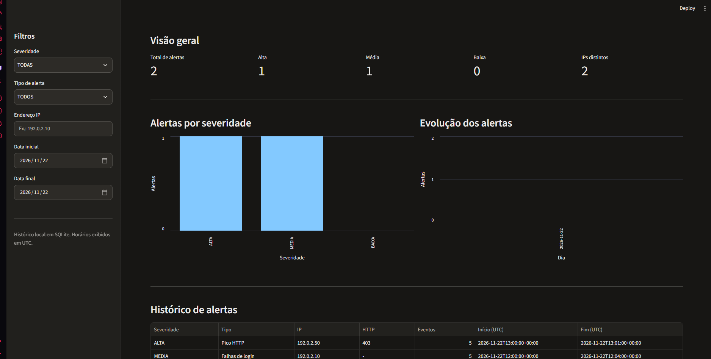

# 🛡️ LogGuard

### Analisador de Logs de Segurança com Python, SQLite e Streamlit

O **LogGuard** é uma aplicação desenvolvida em Python para análise de logs de segurança, identificação de comportamentos suspeitos e visualização de alertas por meio de um dashboard interativo.

O projeto surgiu como uma iniciativa pessoal para aprofundar meus conhecimentos em desenvolvimento de software e segurança da informação, aplicando conceitos de processamento de dados, detecção de anomalias, persistência, testes automatizados e organização de código.

A ferramenta permite analisar arquivos CSV, identificar padrões de falhas de autenticação e erros HTTP, classificar alertas conforme a severidade e armazenar os resultados em um banco de dados SQLite.

Além da execução pelo terminal, o LogGuard possui uma interface web desenvolvida com Streamlit, permitindo acompanhar indicadores, consultar históricos e analisar novos arquivos.

## 📸 Dashboard



O dashboard apresenta uma visão geral dos alertas identificados, incluindo indicadores de severidade, endereços IP distintos, gráficos de distribuição e evolução temporal, além de uma tabela com o histórico das ocorrências.

A interface também permite filtrar os resultados por endereço IP, tipo de alerta, severidade e período.

## 🚀 Funcionalidades

### Análise de logs

- Leitura e processamento de arquivos CSV.
- Validação das colunas obrigatórias.
- Validação de endereços IPv4 e IPv6.
- Validação de datas com fuso horário.
- Normalização de horários para UTC.
- Validação de códigos de resposta HTTP.
- Processamento de eventos fora de ordem.
- Tratamento de arquivos inválidos.

### Detecção de comportamentos suspeitos

- Identificação de múltiplas tentativas malsucedidas de login.
- Detecção de concentrações de respostas HTTP 401, 403 e 404.
- Agrupamento de eventos por endereço IP.
- Análise de eventos em janelas de tempo.
- Identificação de episódios distintos de atividade suspeita.
- Classificação de alertas em severidade baixa, média e alta.

### Histórico de alertas

- Armazenamento local utilizando SQLite.
- Controle de duplicidade.
- Consultas SQL parametrizadas.
- Gravações transacionais.
- Consulta de alertas anteriores.
- Filtros por severidade.
- Registro dos horários de ocorrência e armazenamento.

### Dashboard interativo

- Indicadores de alertas.
- Quantidade de ocorrências por severidade.
- Número de endereços IP distintos.
- Gráficos de distribuição de alertas.
- Visualização da evolução temporal.
- Tabela de histórico.
- Filtros por IP, tipo, severidade e período.
- Importação de arquivos CSV diretamente pelo navegador.
- Integração com o banco SQLite local.

## 🛠️ Tecnologias utilizadas

| Tecnologia | Aplicação |
|---|---|
| Python 3.13 | Linguagem principal |
| Streamlit | Dashboard interativo |
| SQLite | Persistência de alertas |
| CSV | Formato de entrada dos eventos |
| unittest | Testes automatizados |
| Git | Controle de versão |
| GitHub | Hospedagem do código |
| GitHub Actions | Integração contínua |

O projeto utiliza bibliotecas nativas do Python para processamento, análise e persistência. O Streamlit é utilizado para a interface web.

## 🏗️ Arquitetura

O LogGuard foi organizado em módulos com responsabilidades específicas.

| Arquivo | Responsabilidade |
|---|---|
| `main.py` | Execução pelo terminal |
| `dashboard.py` | Interface web com Streamlit |
| `logguard/analisador.py` | Leitura, validação e detecção de alertas |
| `logguard/repositorio.py` | Persistência e consultas SQLite |
| `logguard/painel.py` | Filtros, indicadores e preparação dos gráficos |
| `tests/` | Testes automatizados |
| `exemplos/` | Arquivos CSV de demonstração |

Essa divisão permite reutilizar as regras de análise tanto na interface de terminal quanto no dashboard, evitando a duplicação da lógica de negócio.

## 📁 Estrutura do projeto

```text
logguard/
│
├── .github/
│   └── workflows/
│       └── tests.yml
│
├── .streamlit/
│   └── config.toml
│
├── docs/
│   └── images/
│       └── dashboard.png
│
├── exemplos/
│   ├── eventos.csv
│   └── eventos_http.csv
│
├── logguard/
│   ├── __init__.py
│   ├── analisador.py
│   ├── painel.py
│   └── repositorio.py
│
├── tests/
│   ├── test_analisador.py
│   ├── test_painel.py
│   └── test_repositorio.py
│
├── .gitignore
├── dashboard.py
├── main.py
├── README.md
└── requirements.txt
```

O banco SQLite é criado localmente no diretório `dados/`, que não deve ser enviado ao GitHub.

## ⚙️ Instalação

### Pré-requisitos

- Python 3.13.
- Git.
- Navegador atualizado.

Não é necessário utilizar Docker, WSL ou um servidor externo de banco de dados.

### 1. Clonar o repositório

Abra o PowerShell e execute:

```powershell
git clone https://github.com/fernandoaugustobueno10-wq/logguard.git

cd logguard
```

### 2. Criar o ambiente virtual

```powershell
py -3.13 -m venv .venv
```

### 3. Instalar as dependências

```powershell
.\.venv\Scripts\python.exe -m pip install -r requirements.txt
```

As dependências ficam isoladas no ambiente virtual do projeto.

## 🖥️ Executando o dashboard

No diretório principal:

```powershell
.\.venv\Scripts\python.exe -m streamlit run dashboard.py
```

Após iniciar o servidor, acesse:

**http://127.0.0.1:8501**

O dashboard será aberto no navegador.

Para encerrar a aplicação, pressione `Ctrl+C` no terminal.

### Importando arquivos CSV

1. Abra o dashboard.
2. Expanda a seção de importação.
3. Selecione um arquivo CSV.
4. Clique em **Analisar e salvar alertas**.
5. Consulte os resultados pelos indicadores, gráficos e histórico.

Os alertas identificados são armazenados no SQLite local.

## 💻 Executando pelo terminal

Também é possível utilizar o LogGuard sem abrir o dashboard.

### Analisar falhas de login

```powershell
.\.venv\Scripts\python.exe main.py exemplos\eventos.csv
```

### Analisar e armazenar alertas

```powershell
.\.venv\Scripts\python.exe main.py exemplos\eventos.csv --salvar
```

### Analisar eventos HTTP

```powershell
.\.venv\Scripts\python.exe main.py exemplos\eventos_http.csv --salvar
```

### Consultar o histórico

```powershell
.\.venv\Scripts\python.exe main.py --historico
```

### Consultar apenas alertas de alta severidade

```powershell
.\.venv\Scripts\python.exe main.py --historico --severidade ALTA
```

### Limitar a quantidade de resultados

```powershell
.\.venv\Scripts\python.exe main.py --historico --limite 10
```

O banco padrão é armazenado em:

```text
dados/logguard.sqlite3
```

## 📄 Formato dos arquivos CSV

Os arquivos devem apresentar exatamente quatro colunas:

| Coluna | Descrição | Exemplo |
|---|---|---|
| `timestamp` | Data e horário do evento | `2026-11-22T12:00:00Z` |
| `ip` | Endereço IP | `192.0.2.10` |
| `evento` | Tipo de ocorrência | `login_falha` |
| `status` | Código HTTP | `401` |

Exemplo:

```csv
timestamp,ip,evento,status
2026-11-22T12:00:00Z,192.0.2.10,login_falha,401
2026-11-22T12:01:00Z,192.0.2.10,login_falha,401
2026-11-22T12:02:00Z,192.0.2.10,login_falha,401
2026-11-22T12:03:00Z,192.0.2.10,login_falha,401
2026-11-22T12:04:00Z,192.0.2.10,login_falha,401
```

Os eventos aceitos atualmente são:

- `login_falha`
- `login_sucesso`
- `requisicao`

Os endereços IP utilizados nos exemplos são reservados para documentação, não correspondendo a usuários reais.

## 🔎 Regras de detecção

### 1. Falhas repetidas de autenticação

O LogGuard identifica comportamentos suspeitos quando um mesmo endereço IP apresenta pelo menos cinco eventos de falha de login, com status HTTP 401 ou 403, dentro de uma janela de dez minutos.

A classificação é:

| Condição | Severidade |
|---|---|
| Cinco falhas em até dois minutos | ALTA |
| Cinco falhas em mais de dois e até dez minutos | MÉDIA |

O sistema permite identificar episódios distintos provenientes do mesmo endereço IP.

### 2. Picos de erros HTTP

Também são analisadas concentrações de respostas HTTP 401, 403 e 404.

O limite padrão é de cinco ocorrências, com o mesmo endereço IP e código de status, em uma janela de cinco minutos.

| Código HTTP | Condição | Severidade |
|---|---|---|
| 401 ou 403 | Cinco ocorrências em até um minuto | ALTA |
| 401 ou 403 | Cinco ocorrências em mais de um e até cinco minutos | MÉDIA |
| 404 | Cinco ocorrências em até um minuto | MÉDIA |
| 404 | Cinco ocorrências em mais de um e até cinco minutos | BAIXA |

As regras utilizam limites demonstrativos e podem gerar falsos positivos.

**Um alerta representa um indício para investigação, não a confirmação de um ataque.**

## 🗄️ Persistência com SQLite

O armazenamento permite consultar alertas mesmo depois de encerrar a aplicação.

Cada alerta possui informações como:

- Tipo.
- Severidade.
- Endereço IP.
- Código HTTP, quando aplicável.
- Quantidade de eventos.
- Horário inicial.
- Horário final.
- Data de armazenamento.

Para evitar duplicações, o projeto utiliza uma chave SHA-256 calculada a partir dos dados do alerta.

Quando o mesmo alerta é processado novamente, ele não é inserido outra vez no banco.

As operações utilizam consultas parametrizadas e transações SQLite.


## 🧪 Testes automatizados

O LogGuard possui **60 testes automatizados**, organizados em cinco módulos:

| Módulo | Testes | Finalidade |
|---|---:|---|
| `test_analisador.py` | 20 | Validação de CSV e regras de detecção |
| `test_repositorio.py` | 10 | Persistência, consultas e duplicidade |
| `test_painel.py` | 9 | Filtros, indicadores e dados dos gráficos |
| `test_integracao.py` | 11 | Fluxo completo de importação, detecção e SQLite |
| `test_seguranca.py` | 10 | Limites, codificação e entradas malformadas |
| **Total** | **60** | |

Para executar todos os testes:

```powershell
.\.venv\Scripts\python.exe -m unittest discover -s tests -v
```

Resultado esperado:

```text
Ran 60 tests

OK
```

### Auditoria de dependências

O projeto utiliza `pip-audit` para verificar as dependências Python em busca de vulnerabilidades conhecidas.

A auditoria pode ser executada localmente:

```powershell
.\.venv\Scripts\python.exe -m pip_audit -r requirements.txt
```

No GitHub Actions, os testes funcionais e a auditoria são executados em jobs independentes.

A ausência de vulnerabilidades conhecidas no relatório não garante que o projeto esteja livre de falhas de segurança.

## 🔄 Integração contínua

O projeto utiliza **GitHub Actions** para executar verificações automáticas a cada push ou pull request para a branch principal.

O workflow realiza:

1. Preparação do Python 3.13.
2. Instalação das dependências.
3. Verificação de sintaxe dos arquivos Python.
4. Execução dos testes automatizados.
5. Execução dos exemplos de análise.
6. Verificação básica de armazenamento e consulta SQLite.

As verificações ajudam a identificar regressões antes que novas alterações sejam incorporadas.

[Visualizar GitHub Actions](https://github.com/fernandoaugustobueno10-wq/logguard/actions)

## 🔐 Segurança

O LogGuard foi desenvolvido considerando princípios de validação de entradas e tratamento seguro de dados.

Entre as medidas implementadas estão:

- Validação dos arquivos CSV.
- Limite de 5 MB por arquivo.
- Limite de 20.000 eventos por análise.
- Validação dos campos obrigatórios.
- Validação de endereços IP.
- Validação de códigos HTTP.
- Normalização de horários.
- Consultas SQL parametrizadas.
- Transações para gravações no banco.
- Controle de registros duplicados.
- Tratamento de erros de leitura e armazenamento.
- Processamento temporário dos arquivos importados.
- Execução local do dashboard.
- Exclusão do banco de dados e do ambiente virtual do versionamento.

Os arquivos analisados devem ser tratados como dados não confiáveis.

### Privacidade

Arquivos de log reais podem conter endereços IP e outras informações pessoais ou sensíveis.

Por esse motivo:

- Não publique arquivos reais de produção no GitHub.
- Utilize dados fictícios nas demonstrações.
- Analise somente arquivos que você tenha autorização para processar.
- Mantenha o banco SQLite protegido no ambiente local.
- Não exponha o dashboard diretamente à internet.

O LogGuard é uma ferramenta educacional em desenvolvimento e não substitui sistemas profissionais de monitoramento de segurança.

## ⚠️ Limitações atuais

A aplicação ainda possui algumas limitações:

- Aceita somente o formato CSV documentado.
- Não interpreta diretamente logs brutos de Apache, Nginx ou Windows.
- Não realiza monitoramento contínuo em tempo real.
- Não possui autenticação de usuários.
- Foi desenvolvida para utilização local.
- O dashboard consulta até 1.000 alertas recentes.
- Ainda não possui uma suíte de testes automatizados completa para as interações visuais.
- As regras de detecção podem apresentar falsos positivos.
- Não substitui um sistema SIEM profissional.

## 📌 Melhorias futuras

Entre as possibilidades de evolução estão:

- Suporte a formatos adicionais de logs.
- Novas regras de detecção.
- Exportação de relatórios.
- Testes automatizados de integração.
- Otimização de consultas ao SQLite.
- Novos indicadores de segurança.
- Melhorias de visualização e acessibilidade.
- Documentação de arquitetura.
- Aprimoramento das regras de classificação de alertas.

## 👨‍💻 Autor

**Fernando Augusto Bueno Canquerini**

Estudante de Tecnologia em Análise e Desenvolvimento de Sistemas (TADS) na **Universidade Federal do Paraná (UFPR)**.

Tenho interesse em desenvolvimento de software, desenvolvimento backend, bancos de dados e segurança da informação.

O LogGuard faz parte dos meus projetos pessoais de aprendizado e portfólio, reunindo conhecimentos de programação Python, análise de dados, persistência, desenvolvimento de interfaces e testes de software.

**GitHub:** https://github.com/fernandoaugustobueno10-wq

---

**LogGuard — Projeto pessoal desenvolvido para aprendizado e portfólio.**
